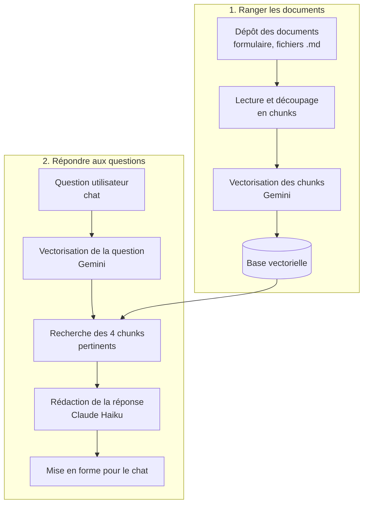

# Assistant documentaire (RAG)

Je pose une question dans un chat, et l'assistant répond uniquement à partir de mes documents, en citant sa source. S'il ne trouve pas l'information, il le dit au lieu d'inventer.

Construit le 5 novembre 2026 avec n8n Cloud, les embeddings Gemini et l'API Claude, sans écrire de code applicatif.

## Le problème

Retrouver une information précise dans sa documentation prend du temps. Une IA classique, elle, répond toujours, quitte à inventer. En entreprise, une réponse fausse mais sûre d'elle est pire que pas de réponse.

## Le principe : RAG (Retrieval-Augmented Generation)

L'assistant cherche d'abord les passages utiles dans mes documents, puis Claude répond à partir de ces seuls passages.

| Qui | Fait quoi | Pourquoi |
|---|---|---|
| **Gemini (embeddings)** | Traduit chaque morceau de document et chaque question en nombres qui représentent leur sens | Deux textes proches ont des nombres proches : on retrouve les bons passages même sans les mêmes mots |
| **n8n (règles)** | Découpe les documents, range les morceaux, cherche les 4 plus proches de la question, met la réponse au propre | Ce qui doit être identique à chaque fois va dans l'outil |
| **Claude Haiku (IA)** | Rédige la réponse à partir des passages trouvés et cite la source | C'est du jugement sur du langage naturel |

## Schéma

## Réglages clés

- **Corpus de test** : 4 documents Markdown (les README de mes projets et un fichier de réglages), découpés en 25 morceaux.
- **Découpage** : morceaux d'environ 1 000 caractères, avec 200 caractères répétés entre deux morceaux pour ne pas couper une idée en deux.
- **Embeddings** : Gemini `gemini-embedding-001` (chaque texte devient une liste de 3 072 nombres). Le même modèle sert à ranger les documents et à lire la question : c'est obligatoire pour qu'ils se comparent.
- **Recherche** : les 4 morceaux les plus proches de la question sont envoyés à Claude, pas les documents entiers (moins cher, plus précis).
- **Claude Haiku 4.5** : température 0,2 (peu de hasard, réponses exactes), 1 000 tokens maximum.
- **Prompt système** : répondre uniquement à partir des passages fournis, tutoyer, signaler les écarts entre documents, citer la source, et répondre « Je ne trouve pas cette information… » quand la réponse n'y est pas.
- **Mise en forme** : la réponse est nettoyée avant d'arriver dans le chat (plus de texte brut technique).

## Où vont les données

| Service | Ce qu'il reçoit | Point d'attention |
|---|---|---|
| Google Gemini (offre gratuite) | Les morceaux de documents et les questions | En offre gratuite, Google peut réutiliser les données pour améliorer ses produits. Acceptable ici car le corpus n'est pas sensible. Pour des documents d'entreprise : offre payante (données non réutilisées) |
| Anthropic (API Claude) | La question et les 4 morceaux trouvés | Clé API dédiée, crédits prépayés sans rechargement automatique |

## Coût

- **Embeddings Gemini** : gratuits (offre Free, prix vérifié sur la page officielle le 5 novembre 2026).
- **Claude Haiku** : un appel par question, avec seulement 4 morceaux en contexte. Coût réel à mesurer sur la console Anthropic après une période d'utilisation.
- **n8n Cloud** : essai gratuit, puis abonnement payant ou installation locale gratuite.

## Tests réalisés

Jeu de 12 questions préparé à l'avance, dont des pièges (information absente du corpus, comparaison entre projets, contradiction entre deux documents).

| Résultat | Nombre |
|---|---|
| Réponse correcte avec source | 10 |
| Réponse partielle | 2 (une comparaison entre projets ; une contradiction dont la source a été mal attribuée) |
| Invention | **0** |

Sur la question piège (une information absente des documents), l'assistant a bien répondu qu'il ne trouvait pas l'information.

## Ce que j'en retiens

- **La qualité des réponses dépend d'abord du corpus.** Le RAG répète fidèlement mes documents, y compris quand ils sont périmés : un chiffre obsolète dans un ancien README est ressorti tel quel.
- **Monter un RAG prend une journée ; le faire vivre est un sujet de chef de projet** : garder le corpus à jour, gérer les droits d'accès, mesurer la qualité des réponses dans le temps.

## Limites connues et pistes

- **La base vectorielle est en mémoire** (Simple Vector Store de n8n) : elle se vide quand n8n redémarre, il faut redéposer les documents. Piste : une base persistante (Supabase).
- **La source est déduite du contenu**, car le nom du fichier n'est pas encore transmis à Claude avec les morceaux. Piste : passer le nom du fichier dans les métadonnées.
- **Le chat n'est pas publié** : le formulaire de dépôt n'a pas d'authentification, il reste donc privé.
- **Alimentation manuelle** : les documents sont déposés à la main. Piste : un déclencheur qui met à jour le corpus quand un document change (Notion, Drive).

Le workflow n8n et le prompt restent privés : démo en direct sur demande.
