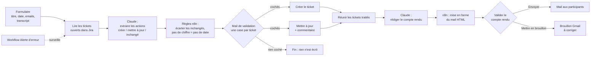

# Réunion → Jira

Après une réunion, je colle le transcript dans un formulaire. Claude propose les tickets Jira à créer ou à mettre à jour, puis rédige le compte rendu. Je valide chaque étape par mail : Jira est à jour sans doublon, et les participants reçoivent un compte rendu propre.

Construit en novembre 2026 avec n8n Cloud, l'API Claude, Jira et Gmail, sans écrire de code applicatif.

## Le problème

Après chaque réunion projet, un chef de projet perd 20 à 40 minutes à relire ses notes, créer ou mettre à jour les tickets et rédiger le compte rendu. Les actions oubliées et les tickets en double font perdre la confiance de l'équipe dans le backlog.

## Le principe : l'IA au bon endroit

| Qui | Fait quoi | Pourquoi |
|---|---|---|
| **Claude (IA)** | Comprend la réunion : repère les actions, les compare aux tickets existants, rédige le compte rendu | C'est du jugement sur du langage naturel |
| **n8n (règles)** | Lit Jira, filtre, met en forme, crée et met à jour les tickets, envoie les mails | Ce qui doit être fiable et identique à chaque fois va dans l'outil |
| **Moi (humain)** | Valide les tickets un par un, puis valide ou corrige le compte rendu | Rien n'arrive dans Jira ni chez les participants sans mon accord |

## Schéma

## Ce que fait le workflow, étape par étape

1. **Formulaire** : titre et date de la réunion, emails des participants, transcript (copié depuis Teams, Meet ou Zoom).
2. **Lire les tickets ouverts** (HTTP Request vers l'API Jira) : Claude doit savoir ce qui existe déjà pour éviter les doublons.
3. **Claude – extraire les actions** : pour chaque action, il choisit `creer`, `mettre_a_jour` (avec la clé du ticket) ou `inchange`, et recopie la phrase du transcript qui le prouve.
4. **Règles n8n** :
   - les actions « inchangées » sont écartées ;
   - **pas de chiffre dans la phrase de preuve = pas d'échéance** (« cette semaine », « la semaine d'après » ne deviennent jamais une date inventée) ;
   - le titre est coupé à 80 caractères.
5. **Validation des tickets** : un seul mail, une case à cocher par ticket. Seuls les tickets cochés passent. Tout décocher = rien n'est écrit.
6. **Jira** : création (POST) ou mise à jour (PUT) + commentaire qui explique ce qui a changé et pourquoi. Chaque ticket touché reçoit l'étiquette `a-verifier` (deuxième filet de sécurité) et une étiquette `resp-Prénom`.
7. **Claude – rédiger le compte rendu** : ordre du jour, participants, points abordés (avec « hors ordre du jour »), décisions, remarques, prochaines étapes.
8. **Mise en forme** (règle n8n) : toujours la même structure, avec le tableau des tickets et leur lien Jira. Si aucun ordre du jour n'a été annoncé en début de réunion, le compte rendu affiche « ⚠️ Aucun ordre du jour annoncé » : l'outil rend visible l'oubli d'une bonne pratique.
9. **Validation du compte rendu** : « Envoyer » part aux participants ; « Mettre en brouillon » crée un brouillon Gmail que je corrige avant d'envoyer.
10. **Alerte d'erreur** : un workflow séparé (Error Trigger) m'envoie un mail avec le nœud en cause, le message d'erreur et le lien vers l'exécution.

## Outils et accès

| Outil | Usage | Accès (moindre privilège) |
|---|---|---|
| n8n Cloud | Orchestration du workflow | Essai 14 jours |
| API Anthropic | Claude Haiku 4.5 (`claude-haiku-4-5-20251001`), 2 appels par réunion | Clé API dédiée, crédits prépayés, sans rechargement automatique |
| Jira Cloud (Free) | Espace « Runlab – Assistant IA » (clé RUN), séparé de mon espace de travail | Jeton API Atlassian rangé dans un credential n8n |
| Gmail | Mails de validation, compte rendu, brouillon, alerte | OAuth limité à « gérer les brouillons et envoyer des e-mails » |

Aucune clé ni aucun jeton n'est stocké en clair : ils restent dans les credentials chiffrés de n8n.

## Coût

Environ **2 centimes par réunion** (estimation : deux appels à Claude Haiku d'environ 3 000 tokens en entrée et 1 000 à 1 500 en sortie chacun). À vérifier sur la console Anthropic après quelques réunions réelles. n8n Cloud : essai gratuit, puis abonnement payant ou installation locale gratuite.

## Tests réalisés

| Test | Ce qu'il vérifie | Résultat |
|---|---|---|
| Kick-off du 3/11 | Extraction et création des tickets | 6 tickets créés |
| Point hebdo du 10/11 | Anti-doublon, changement de responsable, dates floues | Aucun doublon ; erreurs passées de 5 à 3 après le prompt v2.2 et la règle « pas de chiffre, pas de date » (0 date inventée) |
| Tout décocher | Refus | Rien n'est écrit dans Jira |
| Point hebdo du 17/11 | Compte rendu, ordre du jour oral, sujets hors ordre du jour, brouillon | Compte rendu complet et brouillon créé ; extraction 5 tickets sur 9 attendus (voir limites) |
| Erreur d'exemple | Alerte | Mail d'alerte reçu |

Les transcripts de test sont fictifs et anonymisés (prénoms uniquement).

## Limites connues et pistes

- **L'extraction sature sur les réunions riches.** Sur le test du 17/11, Haiku a trouvé 5 actions sur 9 : il regroupe des sujets voisins dans un même ticket et peut inventer un changement de responsable. C'est pour ça que la validation humaine est obligatoire. Piste : comparer avec un modèle plus puissant (Sonnet), en vérifiant le coût.
- **Améliorer un prompt est un compromis.** Le prompt v2.2 a corrigé 2 oublis mais créé 1 nouvelle erreur (une décision prise pour une action). Il faut retester à chaque changement, avec le même jeu de données.
- **La règle « pas de chiffre, pas de date » est volontairement prudente** : « demain » est aussi effacé. Je préfère une date manquante à une date fausse.
- **Les commentaires Jira sont signés de mon nom**, parce que le jeton API est le mien. En production : un compte de service dédié.
- **Le responsable est une étiquette `resp-Prénom`**, pas un vrai compte Jira (Jira Free, un seul utilisateur). En production : une table prénom → compte Jira.
- **Le nœud Jira de n8n ne gère pas l'échéance** : création et mise à jour passent par HTTP Request (API Jira v2).
- **Claude Haiku 5.5 ne convient pas ici** : il réfléchit sans écrire le JSON demandé. Le workflow utilise Haiku 4.5. Les modèles récents refusent aussi le réglage « temperature » : la stabilité vient d'un prompt précis et d'un format imposé.
- **L'alerte d'erreur ne part que pour les vraies exécutions**, pas pendant les tests manuels dans l'éditeur.
- **Dates d'expiration** : accès Gmail OAuth jusqu'au 3/5/2027 ; essai n8n Cloud jusqu'au 18/11/2026.

Le workflow n8n et les prompts restent privés : démo en direct sur demande.
