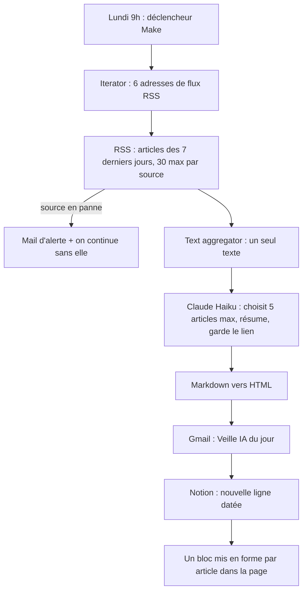

# Veille IA hebdomadaire

Chaque lundi à 9h, je reçois par mail au maximum 5 résumés d'articles IA de moins de 7 jours, tirés de 6 sources, chacun avec son lien. Chaque veille est aussi archivée dans Notion.

## Outils
- **Make** (plan Free) : planification, lecture des flux RSS, filtre de date, regroupement, mise en page, envoi, archivage, gestion des erreurs
- **Claude Haiku** (API Anthropic) : sélection et résumé des articles
- **Gmail** : réception de la veille et des alertes
- **Notion** : archive consultable de toutes les veilles

## Principe : l'IA au bon endroit
Make fait tout ce qui est prévisible (date, lecture, filtre, regroupement, envoi, archivage). Claude Haiku ne fait que ce qui demande du jugement (choisir, résumer). Résultat : moins cher, plus fiable, plus facile à contrôler.

## Fonctionnement

## Sources (flux RSS)
| Source | Flux |
|---|---|
| ActuIA | https://www.actuia.com/feed/ |
| Le Monde Informatique (IA) | https://www.lemondeinformatique.fr/flux-rss/thematique/intelligence-artificielle/rss.xml |
| OpenAI News | https://openai.com/news/rss.xml |
| Google AI Blog | https://blog.google/technology/ai/rss/ |
| TechCrunch (IA) | https://techcrunch.com/category/artificial-intelligence/feed/ |
| The Verge (IA) | https://www.theverge.com/rss/ai-artificial-intelligence/index.xml |

Critère de choix : chaque article du flux a une description (sinon l'IA risquerait d'inventer).

## Réglages clés
- Filtre de date dans le module RSS : `Date from = addDays(now; -7)`. Comme le scénario tourne tous les 7 jours, un article ne peut pas apparaître deux semaines de suite.
- Claude Haiku : Effort Medium, Temperature 0.2, Max Tokens 4000. Le prompt et son historique restent privés (démo sur demande).
- Gestion d'erreur : un error handler sur le module RSS envoie un mail qui nomme la source en panne, puis la saute (directive Skip). La veille part quand même avec les autres sources.
- Archive Notion : une ligne par lundi (nom et date). La réponse de Haiku est découpée à chaque `###`, puis chaque article est mis en forme par Make : titre (Heading 3), résumé, « Pourquoi c'est utile », lien « Lire l'article → » et séparateur. Découper par article évite aussi la limite Notion de 2 000 caractères par bloc.
- Accès minimum : la connexion Make à Notion ne voit que la base « Archive veille IA », rien d'autre de l'espace Notion.

## Coût mesuré (2 novembre 2026)
| Poste | Par lundi | Par mois |
|---|---|---|
| Make | ~20 crédits | ~90 crédits sur 1 000 (plan Free) |
| Claude Haiku | ~21 700 tokens en entrée, ~800 en sortie : ~0,003 $ | ~0,01 $ |

## Limites connues
- La règle « 2 articles maximum par site » et l'exclusion de la robotique ne sont pas toujours respectées par Haiku. Piste : les déplacer dans Make (filtre sur le titre).
- La sélection peut varier d'un lancement à l'autre quand il y a plus de 5 bons articles.
- La mise en forme de l'archive suppose que Haiku écrit chaque article en 4 lignes (titre, résumé, pourquoi, lien). S'il change de format, l'archive sera mal découpée (le mail, lui, reste correct).
- La connexion Gmail de Make doit être réautorisée avant le 24 avril 2027.

## Avancement
Sprint 1 (2 au 6 novembre 2026) : 16 points engagés + 5 points bonus, tous livrés le 2 novembre.
- [x] Lecture des 6 flux dans Make (Iterator + RSS)
- [x] Articles de moins de 7 jours
- [x] Sélection des 5 plus pertinents
- [x] Résumés courts avec lien
- [x] Envoi le lundi à 9h (premier envoi automatique le 9 novembre)
- [x] Alerte en cas d'échec
- [x] Bonus : archive dans Notion, mise en forme
